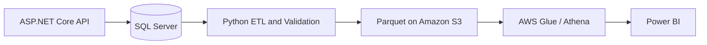

# Enterprise ERP-to-Cloud Analytics System

[English](README.md) | [Türkçe](README.tr.md)

> **Status: Work in progress — Sprint 2.**
> SQL Server persistence and basic API smoke tests have been verified.
> The **Implemented** section describes the current application;
> all other capabilities are planned.

An end-to-end engineering portfolio project that models a focused enterprise **procurement and inventory workflow**, moves operational ERP data to a cloud analytics environment, and presents business insights in Power BI.

The objective is not to recreate a commercial ERP, but to develop **one coherent, testable vertical slice** connecting a transactional backend, a data engineering pipeline, and business analytics using real data flows.

## Planned Architecture



**Currently implemented:** ASP.NET Core API → SQL Server.

The cloud data pipeline and business intelligence components have not been implemented yet.

## Three Connected MVPs

| MVP                        | Scope                                                                                   | Status                                     |
| -------------------------- | --------------------------------------------------------------------------------------- | ------------------------------------------ |
| **1. ERP Backend**         | Purchase requests, approvals, suppliers, purchase orders, goods receipts, and inventory | In progress — initial purchase request API |
| **2. Cloud Data Pipeline** | Python ETL, validation, quarantine, Parquet, Amazon S3, and Athena                      | Planned                                    |
| **3. BI and Analytics**    | Dimensional modeling, Power BI, DAX, and procurement/inventory KPIs                     | Planned                                    |

## Current Status

### Implemented and Verified

- ASP.NET Core Minimal API for purchase requests, including validation and HTTP responses (`201`, `400`, `404`, `409`).
- SQL Server 2022 Developer edition running in Docker Compose, with persistent Docker storage and a loopback-only host port.
- Entity Framework Core integration using `ErpDbContext` and the `InitialCreate` migration.
- Asynchronous database-backed reads and writes, including `AsNoTracking()` for read-only queries.
- Persistence verified across an API restart.
- Database records and migration history inspected using SQL queries.
- PowerShell smoke tests in `tests/smoke_purchase_requests.ps1`, successfully executed with `All smoke tests passed`.
- A direct reference to a patched `System.Security.Cryptography.Pkcs` dependency to address previously reported NuGet security advisories.

### In Progress — Sprint 2

The following improvements are planned but have **not yet been implemented**:

- Isolated integration tests using xUnit, `WebApplicationFactory`, and SQL Server Testcontainers.
- Refactoring `PurchaseRequest` into a class-based entity with a separate request DTO.
- Database-generated request IDs and appropriate SQL constraints.
- Safe migration changes and improved concurrency/error handling.
- An initial operational data contract draft.
- A minimal, budget-controlled S3 → Athena → Power BI connectivity proof of concept.

### Future Development

See the [Roadmap](#roadmap) for the planned ERP workflow, cloud pipeline, and analytics milestones.

## Technology Stack

| Area             | Implemented                               | Planned                                                                             |
| ---------------- | ----------------------------------------- | ----------------------------------------------------------------------------------- |
| Backend          | C#, .NET 10, ASP.NET Core Minimal API     | JWT authentication, role-based authorization, modular domain/application boundaries |
| Data Access      | Entity Framework Core 10, SQL Server 2022 | Expanded transactional ERP schema                                                   |
| Infrastructure   | Docker, Docker Compose                    | GitHub Actions CI, minimal Infrastructure as Code                                   |
| Testing          | PowerShell smoke tests                    | xUnit, `WebApplicationFactory`, SQL Server Testcontainers                           |
| Data Engineering | —                                         | Python, Parquet, Amazon S3, AWS Glue/Athena                                         |
| Analytics        | —                                         | Power BI, DAX                                                                       |

## API Endpoints

| Method | Endpoint                       | Description                            |
| ------ | ------------------------------ | -------------------------------------- |
| `GET`  | `/health`                      | Basic application responsiveness check |
| `GET`  | `/api/purchase-requests`       | List all purchase requests             |
| `GET`  | `/api/purchase-requests/count` | Count purchase requests                |
| `GET`  | `/api/purchase-requests/{id}`  | Get a purchase request by ID           |
| `POST` | `/api/purchase-requests`       | Create a purchase request              |

### Example POST Request

Endpoint:

`POST /api/purchase-requests`

Request body:

```json
{
  "id": 1002,
  "productName": "Keyboard",
  "quantity": 5
}
```

The current API requires the client to provide an **unused positive ID**.

### HTTP Responses

| Case                                                     | Response                               |
| -------------------------------------------------------- | -------------------------------------- |
| Successfully created                                     | `201 Created` with a `Location` header |
| Invalid ID, blank product name, or non-positive quantity | `400 Bad Request`                      |
| Duplicate request ID                                     | `409 Conflict`                         |
| Request not found                                        | `404 Not Found`                        |

**Known design limitation:** Request IDs are currently supplied by the client. Database-generated IDs and separate request DTOs are planned for Sprint 2. The POST contract will change when this refactoring is completed.

## Getting Started

The following instructions target **Windows and PowerShell**.

All commands assume that the terminal is opened in the repository root:

`enterprise-erp-cloud-analytics/`

### Prerequisites

- [.NET 10 SDK](https://dotnet.microsoft.com/download)
- [Docker Desktop](https://www.docker.com/products/docker-desktop/) with the Linux engine running
- PowerShell for the provided smoke tests

### 1. Configure SQL Server

Create a file named:

`infra/.env`

Add the following environment variable:

```dotenv
MSSQL_SA_PASSWORD=REPLACE_WITH_YOUR_STRONG_LOCAL_PASSWORD
```

Replace the example value with your own strong SQL Server password.

The password must satisfy SQL Server's password complexity requirements.

**Never commit `infra/.env` or your actual database password to Git.**

From the repository root, start SQL Server:

```powershell
docker compose --env-file infra/.env -f infra/compose.yaml up -d
```

Check the container:

```powershell
docker compose --env-file infra/.env -f infra/compose.yaml ps
```

The SQL Server container is named:

`erp-sqlserver`

The database is exposed locally at:

`127.0.0.1:14333`

The Docker Compose configuration uses a persistent volume named `erp_sql_data` (the actual Docker volume name may include a Compose project prefix).

### 2. Configure the Database Connection

The application reads its database connection string from .NET User Secrets.

The configuration key is:

`ConnectionStrings:ErpDatabase`

Run the following command from the repository root:

```powershell
dotnet user-secrets set "ConnectionStrings:ErpDatabase" 'Server=tcp:127.0.0.1,14333;Database=ErpCloud;User Id=sa;Password=REPLACE_WITH_YOUR_STRONG_LOCAL_PASSWORD;Encrypt=True;TrustServerCertificate=True;Connection Timeout=10' --project backend/src/ErpCloud.Api
```

Replace `REPLACE_WITH_YOUR_STRONG_LOCAL_PASSWORD` with the same password configured in `infra/.env`.

The SQL Server database name is:

`ErpCloud`

`TrustServerCertificate=True` is used for local development and is not intended as a production TLS configuration.

### 3. Restore Tools and Apply Migrations

The project uses a local .NET tool manifest:

`.config/dotnet-tools.json`

Restore the configured tools:

```powershell
dotnet tool restore
```

Set the environment to Development so EF Core can access the configured User Secrets:

```powershell
$env:DOTNET_ENVIRONMENT = "Development"
```

Apply the database migrations:

```powershell
dotnet ef database update --project backend/src/ErpCloud.Api --startup-project backend/src/ErpCloud.Api
```

Make sure the SQL Server container has finished starting before running the migration command.

The initial migration creates the database schema, including the `PurchaseRequests` table and EF Core migration history.

### 4. Run the API

In a PowerShell terminal:

```powershell
$env:DOTNET_ENVIRONMENT = "Development"
dotnet run --project backend/src/ErpCloud.Api --no-launch-profile -- --urls http://localhost:5004
```

The API will listen at:

`http://localhost:5004`

Open a second PowerShell terminal to test the health endpoint:

```powershell
Invoke-RestMethod http://localhost:5004/health
```

Expected response:

```text
ERP API is running
```

### 5. Create a Purchase Request

In the second PowerShell terminal:

```powershell
Invoke-RestMethod -Uri http://localhost:5004/api/purchase-requests -Method Post -ContentType "application/json" -Body '{"id":1002,"productName":"Keyboard","quantity":5}'
```

Use a different unused positive ID if `1002` already exists.

Retrieve all requests:

```powershell
Invoke-RestMethod http://localhost:5004/api/purchase-requests
```

Retrieve the number of requests:

```powershell
Invoke-RestMethod http://localhost:5004/api/purchase-requests/count
```

### 6. Run Smoke Tests

With the API and SQL Server running, and **at least one purchase request already stored**:

```powershell
.\tests\smoke_purchase_requests.ps1
```

The script verifies:

- Retrieving an existing request by ID.
- Rejecting duplicate request IDs.
- Rejecting negative quantities.
- Rejecting empty product names.
- Rejecting invalid IDs.
- Preserving the record count after rejected POST requests.

Successful execution prints:

```text
All smoke tests passed.
```

These smoke tests run against the **development database**. They are not isolated integration tests.

## Troubleshooting

**Docker connection error**

Start Docker Desktop and wait until its engine is running. Then execute the Docker Compose commands again.

**SQL Server container exits during startup**

Verify `MSSQL_SA_PASSWORD` in `infra/.env` and ensure the password satisfies SQL Server's complexity requirements.

Inspect the logs:

```powershell
docker logs erp-sqlserver
```

**Cannot connect to SQL Server**

Check that the container is running, port `14333` is available, and the User Secrets connection string uses the same password as `infra/.env`.

**Database connection string is missing**

Verify the configuration key:

`ConnectionStrings:ErpDatabase`

Also confirm that the application or EF Core tooling is running in the `Development` environment.

**Smoke tests cannot find an existing record**

Create a valid purchase request using the POST endpoint before running the smoke test.

**PowerShell prevents script execution**

Review the local PowerShell execution policy. Avoid disabling execution protections globally.

## Project Structure

```text
enterprise-erp-cloud-analytics/
├── README.md
├── README.tr.md
├── .config/
│   └── dotnet-tools.json
├── backend/
│   └── src/
│       └── ErpCloud.Api/
│           ├── Models/
│           │   └── PurchaseRequest.cs
│           ├── Data/
│           │   ├── ErpDbContext.cs
│           │   └── Migrations/
│           ├── Program.cs
│           └── ErpCloud.Api.csproj
├── infra/
│   ├── compose.yaml
│   └── .env
└── tests/
    └── smoke_purchase_requests.ps1
```

**Notes:**

- `infra/.env` is local-only and excluded from Git.
- `.config/dotnet-tools.json` contains the local .NET tool configuration.
- The project structure will evolve as new ERP modules are introduced.

## Known Limitations

This project is still in an early development stage.

- Authentication and authorization are not implemented.
- Employees, products, approvals, suppliers, purchase orders, goods receipts, and inventory are not implemented.
- `PurchaseRequest` currently uses client-supplied IDs and a `record` entity; both are scheduled for refactoring.
- Business rules are currently handled directly in Minimal API endpoints.
- Appropriate domain and application boundaries have not yet been introduced.
- SQL Server enforces primary key uniqueness, but concurrent duplicate insert errors are not yet handled robustly by the application.
- The `/health` endpoint checks application responsiveness, not database availability.
- Automated testing currently relies on a PowerShell smoke test rather than isolated database integration tests.
- The SQL Server `sa` account and local certificate configuration are for development only.
- No cloud data pipeline, Athena datasets, or Power BI dashboards have been deployed.

## Roadmap

| Sprint | Focus                                                                                                  | Status                      |
| ------ | ------------------------------------------------------------------------------------------------------ | --------------------------- |
| **0**  | Development environment, Git repository, C# fundamentals                                               | Completed                   |
| **1**  | Initial ASP.NET Core purchase request API                                                              | Completed for initial scope |
| **2**  | SQL Server, EF Core, isolated tests, model improvements, data contract draft, cloud connectivity spike | In progress                 |
| **3**  | Employee/Product foundations, approval workflow, status history, `TimeProvider`, initial CI            | Planned                     |
| **4**  | Suppliers, purchase orders, pricing decisions, JWT, role-based authorization                           | Planned                     |
| **5**  | Goods receipts, inventory movements, transactions, idempotency, concurrency                            | Planned                     |
| **6A** | Backend hardening, automated tests, CI, end-to-end ERP workflow verification                           | Planned                     |
| **6B** | Deterministic historical data generator and v1 data contract                                           | Planned                     |
| **7**  | Python ETL, validation, quarantine, Parquet, Amazon S3, execution manifests                            | Planned                     |
| **8**  | Athena, reconciliation, curated fact and dimension tables                                              | Planned                     |
| **9**  | Power BI semantic model, DAX measures, dashboards                                                      | Planned                     |
| **10** | Full end-to-end validation, documentation, and demonstration                                           | Planned                     |

A more detailed technical roadmap may be maintained under `docs/` as the implementation progresses.

## Design Principles

- Build a coherent, testable vertical slice instead of a full commercial ERP clone.
- Start with a Minimal API and introduce modular architecture as the workflow grows.
- Prefer a modular monolith over premature microservices.
- Use SQL Server as the operational source of truth.
- Validate business rules at appropriate application and database boundaries.
- Prioritize reproducible testing and deterministic historical data.
- Preserve data consistency across operational and analytical systems.
- Keep sensitive credentials out of version control.
- Clearly distinguish implemented features from planned functionality.

## Author

Developed by [@zelihakb](https://github.com/zelihakb) as a hands-on software engineering and data engineering portfolio project.

_Last updated: October 25, 2026._
