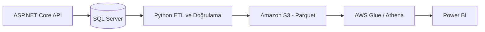

# Enterprise ERP-to-Cloud Analytics System

[English](README.md) | [Türkçe](README.tr.md)

> **Durum: Geliştirme aşamasında — Sprint 2.**
> SQL Server kalıcılığı ve temel API smoke testleri doğrulandı.
> **Tamamlananlar** bölümü mevcut sistemi, diğer bölümler ise planlanan geliştirmeleri açıklar.

Kurumsal bir **satın alma ve stok yönetimi iş akışını** belirli bir kapsamda simüle eden; operasyonel ERP verilerini bulut analitik ortamına taşıyıp Power BI panolarıyla sunmayı hedefleyen uçtan uca bir yazılım ve veri mühendisliği portfolyo projesi.

Amaç, ticari bir ERP sisteminin tamamını yeniden oluşturmak değil; işlemsel backend, veri mühendisliği hattı ve iş zekâsının **gerçek veri akışlarıyla birbirine bağlandığı, test edilebilir ve tutarlı bir sistem** geliştirmektir.

## Planlanan Mimari



**Şu an yalnızca ASP.NET Core API → SQL Server bölümü uygulanmıştır.**

Bulut veri hattı ve Power BI panoları henüz geliştirilmemiştir.

## Üç Bağlantılı MVP

| MVP                          | Kapsam                                                                                 | Durum                                         |
| ---------------------------- | -------------------------------------------------------------------------------------- | --------------------------------------------- |
| **1. ERP Backend**           | Satın alma talepleri, onay, tedarikçi, satın alma siparişi, mal kabul ve stok yönetimi | Devam ediyor — temel satın alma talebi API'si |
| **2. Bulut Veri Hattı**      | Python ETL, veri doğrulama, karantina, Parquet, Amazon S3 ve Athena                    | Planlandı                                     |
| **3. İş Zekâsı ve Analitik** | Boyutsal modelleme, Power BI, DAX ve satın alma/stok KPI'ları                          | Planlandı                                     |

## Güncel Durum

### Tamamlanan ve Doğrulananlar

- Satın alma talebi endpoint'lerini içeren ASP.NET Core Minimal API.
- Temel veri doğrulama kuralları ve uygun HTTP durum kodları (`201`, `400`, `404`, `409`).
- Docker Compose üzerinde çalışan SQL Server 2022 Developer.
- Kalıcı Docker volume'u ve yalnızca yerel bağlantıya açık SQL Server portu.
- Entity Framework Core entegrasyonu, `ErpDbContext` ve `InitialCreate` migration'ı.
- Asenkron veritabanı okuma/yazma işlemleri.
- Salt okunur sorgularda `AsNoTracking()` kullanımı.
- API yeniden başlatıldıktan sonra verilerin korunduğunun doğrulanması.
- SQL sorgularıyla kayıtların ve migration geçmişinin incelenmesi.
- `tests/smoke_purchase_requests.ps1` ile başarılı smoke testleri.
- NuGet güvenlik uyarıları için `System.Security.Cryptography.Pkcs` paketinin güvenlik yamalı sürümüne doğrudan referans eklenmesi.

### Devam Edenler — Sprint 2

Henüz uygulanmamış geliştirmeler:

- xUnit, `WebApplicationFactory` ve SQL Server Testcontainers ile izole entegrasyon testleri.
- `PurchaseRequest` modelinin class tabanlı entity'ye dönüştürülmesi.
- Ayrı bir istek DTO'sunun oluşturulması.
- Talep ID'lerinin veritabanı tarafından üretilmesi.
- Gerekli SQL kısıtlarının tanımlanması.
- Migration yapısının güvenli biçimde güncellenmesi.
- Eşzamanlı isteklerde hata yönetiminin iyileştirilmesi.
- Operasyonel veri sözleşmesinin ilk taslağı.
- S3 → Athena → Power BI bağlantısının düşük maliyetli teknik denemesi.

Diğer geliştirmeler için [Yol Haritası](#yol-haritası) bölümüne bakabilirsiniz.

## Teknolojiler

| Alan              | Kullanılan                                | Planlanan                                                 |
| ----------------- | ----------------------------------------- | --------------------------------------------------------- |
| Backend           | C#, .NET 10, ASP.NET Core Minimal API     | JWT, rol bazlı yetkilendirme, modüler mimari              |
| Veri Erişimi      | Entity Framework Core 10, SQL Server 2022 | Genişletilmiş ERP veri modeli                             |
| Altyapı           | Docker, Docker Compose                    | GitHub Actions CI, temel Infrastructure as Code           |
| Test              | PowerShell smoke testleri                 | xUnit, `WebApplicationFactory`, SQL Server Testcontainers |
| Veri Mühendisliği | —                                         | Python, Parquet, Amazon S3, AWS Glue/Athena               |
| Analitik          | —                                         | Power BI, DAX                                             |

## API Uç Noktaları

| Metot  | Endpoint                       | Açıklama                                         |
| ------ | ------------------------------ | ------------------------------------------------ |
| `GET`  | `/health`                      | Uygulamanın yanıt verip vermediğini kontrol eder |
| `GET`  | `/api/purchase-requests`       | Satın alma taleplerini listeler                  |
| `GET`  | `/api/purchase-requests/count` | Toplam talep sayısını döndürür                   |
| `GET`  | `/api/purchase-requests/{id}`  | Belirli bir talebi ID ile getirir                |
| `POST` | `/api/purchase-requests`       | Yeni satın alma talebi oluşturur                 |

### Örnek POST İsteği

Endpoint:

`POST /api/purchase-requests`

İstek gövdesi:

```json
{
  "id": 1002,
  "productName": "Keyboard",
  "quantity": 5
}
```

Mevcut API'de `id` alanını istemci gönderir. Daha önce kullanılmamış, pozitif bir ID seçilmelidir.

### HTTP Yanıtları

| Durum                                                 | Yanıt                               |
| ----------------------------------------------------- | ----------------------------------- |
| Başarılı kayıt oluşturma                              | `201 Created` ve `Location` başlığı |
| Geçersiz ID, boş ürün adı veya pozitif olmayan miktar | `400 Bad Request`                   |
| Aynı ID ile yeniden kayıt oluşturma                   | `409 Conflict`                      |
| Talebin bulunamaması                                  | `404 Not Found`                     |

**Bilinen sınırlama:** Talep ID'lerinin veritabanı tarafından üretilmesi ve ayrı bir istek DTO'sunun kullanılması Sprint 2 kapsamında planlanmıştır.

## Kurulum

Aşağıdaki komutlar **Windows ve PowerShell** ortamı içindir.

Tüm komutlar projenin ana klasöründe çalıştırılmalıdır:

`enterprise-erp-cloud-analytics/`

### Gereksinimler

- [.NET 10 SDK](https://dotnet.microsoft.com/download)
- [Docker Desktop](https://www.docker.com/products/docker-desktop/)
- Smoke testlerini çalıştırmak için PowerShell

### 1. SQL Server'ı Yapılandır

`infra/.env` dosyasını oluştur ve aşağıdaki değişkeni ekle:

```dotenv
MSSQL_SA_PASSWORD=BURAYA_GUCLU_YEREL_SIFRENI_YAZ
```

Örnek değeri SQL Server'ın parola gereksinimlerini karşılayan güçlü bir şifreyle değiştir.

**Gerçek şifreni veya `infra/.env` dosyasını Git'e ekleme.**

Proje ana klasöründeyken:

```powershell
docker compose --env-file infra/.env -f infra/compose.yaml up -d
```

Container durumunu kontrol et:

```powershell
docker compose --env-file infra/.env -f infra/compose.yaml ps
```

SQL Server container adı:

`erp-sqlserver`

Yerel bağlantı adresi:

`127.0.0.1:14333`

Veriler, Docker Compose yapılandırmasındaki `erp_sql_data` volume'unda saklanır. Gerçek volume adına Compose proje öneki eklenebilir.

### 2. Veritabanı Bağlantısını Ayarla

Uygulama, bağlantı dizesini .NET User Secrets üzerinden okur.

Kullanılan yapılandırma anahtarı:

`ConnectionStrings:ErpDatabase`

Proje ana klasöründe:

```powershell
dotnet user-secrets set "ConnectionStrings:ErpDatabase" 'Server=tcp:127.0.0.1,14333;Database=ErpCloud;User Id=sa;Password=BURAYA_GUCLU_YEREL_SIFRENI_YAZ;Encrypt=True;TrustServerCertificate=True;Connection Timeout=10' --project backend/src/ErpCloud.Api
```

Örnek şifreyi `infra/.env` dosyasında kullandığın şifreyle değiştir.

Veritabanı adı:

`ErpCloud`

`TrustServerCertificate=True` yalnızca yerel geliştirme ortamı için kullanılmaktadır.

### 3. Migration'ları Uygula

Yerel .NET araçlarını yükle:

```powershell
dotnet tool restore
```

Geliştirme ortamını etkinleştir:

```powershell
$env:DOTNET_ENVIRONMENT = "Development"
```

Migration'ları uygula:

```powershell
dotnet ef database update --project backend/src/ErpCloud.Api --startup-project backend/src/ErpCloud.Api
```

Bu işlem, SQL Server hazır olduğunda `ErpCloud` veritabanı şemasını ve gerekli tabloları oluşturur.

### 4. API'yi Çalıştır

PowerShell terminalinde:

```powershell
$env:DOTNET_ENVIRONMENT = "Development"
dotnet run --project backend/src/ErpCloud.Api --no-launch-profile -- --urls http://localhost:5004
```

API adresi:

`http://localhost:5004`

İkinci bir PowerShell terminalinde:

```powershell
Invoke-RestMethod http://localhost:5004/health
```

Beklenen yanıt:

```text
ERP API is running
```

### 5. Satın Alma Talebi Oluştur

```powershell
Invoke-RestMethod -Uri http://localhost:5004/api/purchase-requests -Method Post -ContentType "application/json" -Body '{"id":1002,"productName":"Keyboard","quantity":5}'
```

`1002` daha önce kullanılmışsa farklı ve pozitif bir ID seç.

Kayıtları listele:

```powershell
Invoke-RestMethod http://localhost:5004/api/purchase-requests
```

Kayıt sayısını öğren:

```powershell
Invoke-RestMethod http://localhost:5004/api/purchase-requests/count
```

### 6. Smoke Testlerini Çalıştır

SQL Server ve API çalışırken, veritabanında en az bir talep bulunması koşuluyla:

```powershell
.\tests\smoke_purchase_requests.ps1
```

Test betiği şu kontrolleri gerçekleştirir:

- Mevcut talebin ID üzerinden sorgulanması.
- Tekrarlanan ID'nin reddedilmesi.
- Negatif miktarın reddedilmesi.
- Boş ürün adının reddedilmesi.
- Geçersiz ID'nin reddedilmesi.
- Reddedilen POST isteklerinden sonra kayıt sayısının korunması.

Başarılı çalışmada:

```text
All smoke tests passed.
```

Bu betik **geliştirme veritabanını kullanır**. Henüz bağımsız ve izole bir entegrasyon test altyapısı değildir.

## Proje Yapısı

```text
enterprise-erp-cloud-analytics/
├── README.md
├── README.tr.md
├── .config/
│   └── dotnet-tools.json
├── backend/
│   └── src/
│       └── ErpCloud.Api/
│           ├── Models/
│           │   └── PurchaseRequest.cs
│           ├── Data/
│           │   ├── ErpDbContext.cs
│           │   └── Migrations/
│           ├── Program.cs
│           └── ErpCloud.Api.csproj
├── infra/
│   ├── compose.yaml
│   └── .env
└── tests/
    └── smoke_purchase_requests.ps1
```

**Notlar:**

- `infra/.env` yalnızca yerel ortamda bulunur ve Git tarafından takip edilmez.
- `.config/dotnet-tools.json`, yerel .NET araçlarının yapılandırmasını içerir.
- Yeni modüller eklendikçe proje klasör yapısı genişletilecektir.

## Bilinen Sınırlamalar

Proje henüz erken geliştirme aşamasındadır.

- Kimlik doğrulama ve yetkilendirme henüz uygulanmadı.
- Çalışan, ürün, onay, tedarikçi, satın alma siparişi, mal kabul ve stok modülleri henüz bulunmuyor.
- Satın alma talebi ID'si istemci tarafından gönderiliyor.
- `PurchaseRequest` şimdilik EF Core için `record` olarak tanımlı; class tabanlı entity'ye dönüştürülecek.
- İş kuralları doğrudan Minimal API endpoint'lerinde yer alıyor.
- Domain ve application katmanları henüz ayrılmadı.
- Eşzamanlı mükerrer kayıt girişimlerinde hata yönetimi henüz tam olarak ele alınmadı.
- `/health` endpoint'i veritabanı bağlantısını kontrol etmiyor.
- Test altyapısı şimdilik geliştirme veritabanında çalışan smoke testleriyle sınırlı.
- SQL Server `sa` hesabı ve yerel sertifika yapılandırması yalnızca geliştirme ortamına yönelik.
- Bulut veri hattı, Athena veri kümeleri ve Power BI panoları henüz oluşturulmadı.

## Yol Haritası

| Sprint | Odak                                                                                                          | Durum                 |
| ------ | ------------------------------------------------------------------------------------------------------------- | --------------------- |
| **0**  | Geliştirme ortamı, Git ve temel C#                                                                            | Tamamlandı            |
| **1**  | İlk ASP.NET Core satın alma talebi API'si                                                                     | İlk kapsam tamamlandı |
| **2**  | SQL Server, EF Core, izole testler, model iyileştirmeleri, veri sözleşmesi taslağı ve bulut bağlantı denemesi | Devam ediyor          |
| **3**  | Employee/Product temelleri, onay akışı, durum geçmişi, `TimeProvider`, ilk CI                                 | Planlandı             |
| **4**  | Tedarikçiler, satın alma siparişleri, fiyatlandırma, JWT ve rol bazlı yetkilendirme                           | Planlandı             |
| **5**  | Mal kabul, stok hareketleri, transaction, idempotency ve eşzamanlılık                                         | Planlandı             |
| **6A** | Backend testleri, CI, hata yönetimi ve ERP uçtan uca doğrulaması                                              | Planlandı             |
| **6B** | Tekrarlanabilir sentetik geçmiş veri üretimi ve v1 veri sözleşmesi                                            | Planlandı             |
| **7**  | Python ETL, doğrulama, karantina, Parquet, Amazon S3                                                          | Planlandı             |
| **8**  | Athena, veri uzlaştırma, fact ve dimension tabloları                                                          | Planlandı             |
| **9**  | Power BI, DAX, analitik model ve panolar                                                                      | Planlandı             |
| **10** | Uçtan uca doğrulama, dokümantasyon ve demo                                                                    | Planlandı             |

Daha ayrıntılı mimari ve teknik kararlar, proje geliştikçe `docs/` klasörü altında belgelendirilebilir.

Geniş kapsamlı teknik açıklamalar için [İngilizce README](README.md) ana referanstır.

## Tasarım İlkeleri

- Ticari bir ERP'nin tamamını kopyalamak yerine tutarlı ve test edilebilir bir iş akışı geliştirmek.
- Basit bir Minimal API ile başlayıp ihtiyaç oldukça modüler mimariye geçmek.
- Gereksiz mikroservis karmaşıklığından kaçınmak.
- SQL Server'ı operasyonel verinin temel kaynağı olarak kullanmak.
- İş kurallarını uygun uygulama ve veritabanı katmanlarında doğrulamak.
- Tekrarlanabilir testlere ve deterministik veri üretimine öncelik vermek.
- Operasyonel sistemle analitik sistem arasındaki veri tutarlılığını korumak.
- Gizli bilgileri sürüm kontrolünden uzak tutmak.
- Tamamlanan ve planlanan özellikleri açıkça ayırmak.

## Geliştirici

[@zelihakb](https://github.com/zelihakb) tarafından yazılım ve veri mühendisliği alanında uygulamalı öğrenme ve portfolyo amacıyla geliştirilmektedir.

_Son güncelleme: 25 Ekim 2026._
